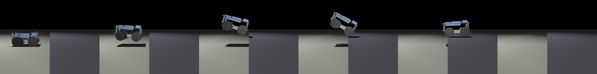
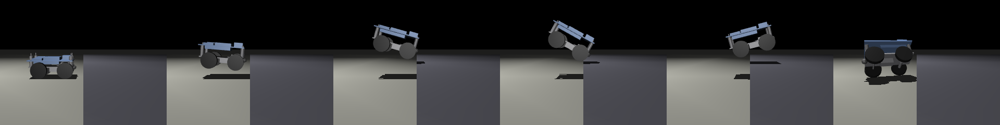
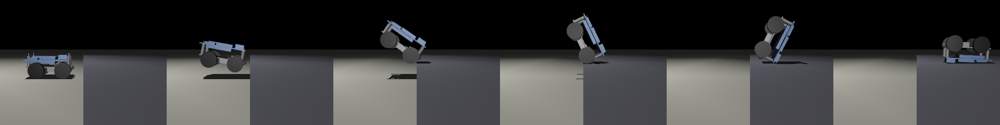

# 物理演算による事前検証の結果

生成：2026-10-29（`cd sim && make report`）。数値の前提は `sim/matrix_sim/params.py`、限界は `sim/README.md`。
形状：部品モデル（model/export）。実測で置き換えた値：なし（モーターの特性・摩擦・接触の硬さは推定値。実測で合わせ込むまで目安として読む）。

## 1. 寸法の干渉（部品の外形）

- なし

重心（parts.json の値とメッシュから計算した値の差。2mm を超えたら、密度の違う部品を分けて書き出す）：
- 下段：0.0mm
- 上段：0.0mm

## 2. カムとジャンプ用モーター（計算）

| 項目 | 値 |
|---|---|
| 必要トルク（摩擦なし／摩擦込み） | 0.037 ／ 0.074 N·m |
| 高減速 N20 の停動トルク（3.7V、推定） | 0.185 N·m |
| 停動トルクに対する割合 | 40%（基準 50% 以下） |
| チャージ時間（発射 → 次のチャージ完了） | 3.97 秒（目標 3〜4 秒） |

## 3. その場ジャンプ（前傾角ごと）

走行モーターは採用案（Pololu136）。前傾 20° の着地は走行モーターの電気ブレーキ（逆起電力）の強さでも変わる：300rpm だとひっくり返る、Pololu136 だとひっくり返る。

| 前傾 | 車輪の上がった高さ | 滞空（1 回目） | 着地後の姿勢 | 上段の最大加速度（発射〜着地） |
|---|---|---|---|---|
| 0° | 41mm | 0.19 秒 | 傾く | 62g |
| 10° | 37mm | 0.18 秒 | ひっくり返る | 60g |
| 15° | 35mm | 0.18 秒 | ひっくり返る | 61g |
| 20° | 33mm | 0.19 秒 | ひっくり返る | 60g |
| 25° | 31mm | 0.79 秒 | ひっくり返る | 60g |
| 30° | 29mm | 0.79 秒 | ひっくり返る | 61g |

## 4. 助走付きの段差越え（高さ 30mm）

発射した瞬間の「車体の前端から段差までの距離」（mm）ごとに、10 回中の成功回数。ばらつき：床の摩擦 0.5〜1.0、上段の質量 ±10%、ばね ±10%、発射タイミング ±20ms。合格は 8 回以上（設計書② 1章）。
「タイミングの幅」は合格する距離の幅を走行の速さで時間に直したもの。操作者がこの幅の中で Space を押す必要がある。

| 案 | 速さ | 0 | 5 | 10 | 15 | 20 | 25 | 30 | 35 | 40 | 45 | 50 | 55 | 60 | タイミングの幅 |
|---|---|---|---|---|---|---|---|---|---|---|---|---|---|---|---|
| 前傾 0°・Pololu136 | 0.52m/s | 0 | 0 | 2 | 5 | 7 | **10** | **10** | **10** | **10** | **9** | 6 | 5 | 1 | 39ms |
| 前傾 0°・300rpm | 0.25m/s | 0 | 1 | 1 | 0 | 0 | 0 | 0 | 0 | 0 | 0 | 0 | 0 | 0 | 0ms |
| 前傾 0°・500rpm | 0.41m/s | 0 | 0 | 2 | 5 | 7 | **10** | **10** | **10** | **10** | **9** | 7 | 5 | 0 | 48ms |
| 前傾 0°・1000rpm | 0.83m/s | 0 | 0 | 0 | 0 | 0 | 1 | 0 | 0 | 1 | 3 | 4 | 6 | 6 | 0ms |
| 前傾 10°・300rpm | 0.25m/s | 0 | 0 | 4 | 6 | 1 | 0 | 0 | 0 | 0 | 0 | 0 | 0 | 0 | 0ms |
| 前傾 10°・500rpm | 0.41m/s | 0 | 0 | 0 | 2 | 4 | 7 | 7 | 7 | 3 | 2 | 0 | 0 | 0 | 0ms |
| 前傾 20°・300rpm | 0.25m/s | 0 | 0 | 0 | 0 | 0 | 0 | 0 | 0 | 0 | 0 | 0 | 0 | 0 | 0ms |
| 前傾 20°・500rpm | 0.41m/s | 0 | 0 | 0 | 0 | 0 | 0 | 0 | 0 | 0 | 0 | 0 | 0 | 0 | 0ms |

コマ送り（横から。発射の直前 → 0.03 → 0.08 → 0.14 → 0.22 → 0.6 秒後）：

- 前傾 0°・Pololu136、40mm 手前で発射

  

- 前傾 0°・300rpm、20mm 手前で発射

  

- 前傾 20°・500rpm、25mm 手前で発射

  

## 5. 落下（30cm、設計書② 8章）

| 項目 | 値 |
|---|---|
| 上段の最大加速度 | 194g（上下段のストッパーと床の接触の硬さ＝推定値に強く依存する。基準値は実測後に決める） |
| 着地後の姿勢 | ひっくり返る |
| 跳ね返り | 83mm（縮んだばねが伸び返す分。ばねの減衰と O リングの効果は推定） |
